# Schéma de la Base de Données

Ce document présente le schéma de la base de données MongoDB de l'application Orthographe Plus Junior.

## Diagramme Entité-Association (ERD)

```mermaid
erDiagram
    users {
        objectId _id PK
        string email UK
        string firstName
        string lastName
        string role
        string profilePicture
        objectId schoolId FK
        objectId classId FK
        bool isSchoolLicense
        string countryId FK
        objectId gradeLevelId FK
        string timezone
        objectId currentProgressId FK
        int progressSummary_streak
        date progressSummary_lastActivityAt
        int progressSummary_xp
        int progressSummary_gamificationLevel
        int progressSummary_dailyLessons_count
        date progressSummary_dailyLessons_periodStart
        int totalConnectionDuration
        string passwordHash
        string saltHash
        object passwordMetadata
        date createdAt
    }

    subscriptions {
        objectId _id PK
        objectId userId FK
        string plan
        string status
        date startedAt
        date expiresAt
        bool cancelAtPeriodEnd
    }

    schools {
        objectId _id PK
        string name
        string country
        objectId schoolAdminId FK
        object licences
    }

    school-invitations {
        objectId _id PK
        objectId schoolId FK
        objectId invitedByUserId FK
        string email
        string role
        string status
        string token UK
        date createdAt
        date expiresAt
        date acceptedAt
        objectId userId FK
    }

    activity-logs {
        objectId _id PK
        objectId userId FK
        objectId schoolId FK
        string type
        date timestamp
        string details
    }

    categories {
        objectId _id PK
        string name UK
    }

    rules {
        objectId _id PK
        string name UK
        object data
        objectId categoryId FK
    }

    questions {
        objectId _id PK
        objectId ruleId FK
        string type
        bool isDisabled
        object data
        array data_options "id, text"
        array data_answer "string"
    }

    countries {
        string _id PK
        string name
    }

    grade-levels {
        objectId _id PK
        int level UK
        array grades "countryId, name"
    }

    programs {
        objectId _id PK
        string name
        objectId gradeLevelId FK, UK
        array lessons "lessonId, order"
        date createdAt
        date updatedAt
    }

    lessons {
        objectId _id PK
        string name
        string type
        array rules "ruleId, order"
        int minScore
        date createdAt
        date updatedAt
    }

    settings {
        string _id PK
        int maxLessonsPerDay
        int numberOfQuestionsPerRule
        object dailyReset
        date createdAt
        date updatedAt
    }

    user-progresses {
        objectId _id PK
        objectId userId FK
        objectId programId FK
        objectId currentLessonId FK
        date startedAt
        date completedAt
        array seenCategories "categoryId"
        array seenRules "ruleId"
    }

    learning-sessions {
        objectId _id PK
        objectId userId FK
        objectId userProgressId FK
        string type
        string status
        objectId lessonId FK
        int attemptNumber
        int scorePercentage
        bool isPassed
        int currentQuestionIndex
        array questions "questionId, userAnswer, isCorrect, answeredAt"
        int duration
        date startedAt
        date completedAt
        array xpGained "type, amount"
    }

    classes {
        objectId _id PK
        string name
        objectId schoolId FK
        objectId gradeLevelId FK
        date createdAt
    }

    student-invitations {
        objectId _id PK
        string email
        string firstName
        string lastName
        objectId schoolId FK
        objectId classId FK
        string token UK
        string status
        objectId invitedByUserId FK
        objectId acceptedByUserId FK
        date createdAt
        date updatedAt
        date acceptedAt
        date expiresAt
    }

    %% Relations (Liens et cles etrangeres)
    users ||--o| schools : "appartient a au plus une (schoolId)"
    users ||--o| classes : "inscrit dans au plus une (classId)"
    users ||--o| countries : "habite (countryId)"
    users ||--o| grade-levels : "niveau (gradeLevelId)"
    users ||--o| user-progresses : "progression actuelle (currentProgressId)"
    
    %% Relations inverses pour l'utilisateur
    users ||--o{ subscriptions : "possede des (userId)"
    users ||--o{ activity-logs : "genere des (userId)"
    users ||--o{ user-progresses : "a pour progressions (userId)"
    users ||--o{ learning-sessions : "a effectue des (userId)"
    
    schools ||--o| users : "administre par (schoolAdminId)"
    schools ||--o{ classes : "contient (schoolId)"
    schools ||--o{ school-invitations : "a des invitations (schoolId)"
    schools ||--o{ student-invitations : "a des invitations eleves (schoolId)"
    schools ||--o{ activity-logs : "enregistre (schoolId)"
    
    school-invitations ||--o| users : "invite par (invitedByUserId)"
    school-invitations ||--o| users : "accepte par (userId)"
    
    activity-logs ||--o| users : "action de (userId)"
    activity-logs ||--o| schools : "dans l ecole (schoolId)"
    
    categories ||--o{ rules : "contient (categoryId)"
    
    rules ||--o{ questions : "teste par (ruleId)"
    
    programs ||--o| grade-levels : "pour le niveau (gradeLevelId)"
    
    user-progresses ||--o| users : "progression de (userId)"
    user-progresses ||--o| programs : "suit le programme (programId)"
    user-progresses ||--o| lessons : "lecon courante (currentLessonId)"
    user-progresses ||--o{ learning-sessions : "contient (userProgressId)"
    
    learning-sessions ||--o| users : "effectuee par (userId)"
    learning-sessions ||--o| user-progresses : "liee a (userProgressId)"
    learning-sessions ||--o| lessons : "concerne (lessonId)"
    
    classes ||--o| schools : "appartient a (schoolId)"
    classes ||--o| grade-levels : "de niveau (gradeLevelId)"
    
    student-invitations ||--o| schools : "pour l ecole (schoolId)"
    student-invitations ||--o| classes : "pour la classe (classId)"
    student-invitations ||--o| users : "invite par (invitedByUserId)"
    student-invitations ||--o| users : "accepte par (acceptedByUserId)"

```

## Résumé des Collections

- **`users`** : Gère les informations des utilisateurs (élèves, professeurs, admins).
- **`subscriptions`** : Gère les abonnements des utilisateurs.
- **`schools`** & **`classes`** : Structure organisationnelle des établissements scolaires.
- **`countries`** & **`grade-levels`** : Données géographiques et niveaux scolaires.
- **`school-invitations`** & **`student-invitations`** : Gère les processus d'invitations pour rejoindre une école ou une classe.
- **`activity-logs`** : Historique et traçabilité des actions réalisées.
- **`programs`**, **`lessons`**, **`rules`**, **`categories`**, **`questions`** : Le cœur de l'apprentissage (programmes, leçons, règles de grammaire/orthographe, et questions d'exercices).
- **`user-progresses`** & **`learning-sessions`** : Le suivi de progression des élèves, leurs statistiques et le détail de chaque session d'apprentissage (réponses, XP, temps).
- **`settings`** : Configurations globales et limites du système.
